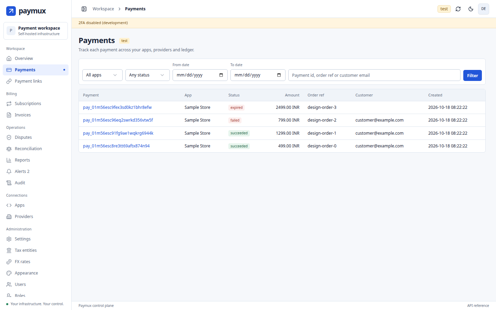

<div align="center">

# Paymux

### Self-hosted payment orchestration for small teams

**One webhook endpoint. One ledger. Every payment gateway.**<br>
Razorpay · Stripe · Cashfree · PayU · Zoho Payments · Whop, **or any gateway you add**, in a single Go binary with GST invoicing built in.

[](https://github.com/velixio/paymux/releases/latest)
[](https://github.com/velixio/paymux/actions/workflows/ci.yml)
[](LICENSE)
[](go.mod)
[](#-faq)
[](docs/provider-verification.md)
[](https://supermetry.com)

[**Quick start**](#-quick-start-in-5-minutes) · [Why Paymux](#-why-paymux) · [Gateways](#-supported-payment-gateways) · [GST for India](#-built-for-india) · [Docs](docs/README.md) · [FAQ](#-faq)



</div>

---

## 😩 Why Paymux

Payment gateways give your company **one account and one webhook URL**. The moment you run
two or three products on it, every product receives every payment notification, and each
app grows its own copy of the same refund screen, dispute tracking and reconciliation code.
Your accountant still wants GST invoices.

Paymux sits between your apps and your gateways and does that work once.

| Without Paymux | With Paymux |
|---|---|
| Every app integrates every gateway | Each app integrates **once**, with a small JSON API |
| One gateway webhook URL shared by all your sites | Paymux receives, **verifies** and forwards a signed event to the right app only |
| Payments, refunds and disputes spread over five dashboards | **One ledger**, one dashboard |
| Changing gateway means rewriting checkout code | **Routing rules** pick the gateway by currency, app or amount |
| GST invoices typed by hand | Tax invoices and credit notes **issued automatically** |

```
 app A ─┐                                    ┌─ Razorpay
 app B ─┼── /v1 API ──►   Paymux   ◄─ webhooks ─┼─ Stripe · Cashfree
 app C ─┘ ◄── signed webhooks ──┘            ├─ PayU India · Zoho Payments
                                             ├─ Whop
                                             └─ your own gateway (Go package or HTTP service)
```

## ✨ What you get

- 🔀 **Smart routing.** Rules by app, currency, country and amount, with a circuit breaker that skips a gateway that keeps failing.
- 📒 **One trustworthy ledger.** Payments, refunds, disputes, subscriptions and payouts. A gateway webhook is only a hint: Paymux re-fetches the truth before it changes anything.
- 🧾 **GST invoices out of the box.** CGST/SGST or IGST, LUT exports, credit notes, e-invoice JSON, digitally signed PDFs.
- 🔁 **Subscriptions.** Gateway-managed (Razorpay, Stripe, Whop) and Paymux-managed on UPI AutoPay, card and e-mandates, with dunning and RBI pre-debit rules.
- 🔔 **Signed webhooks to your apps** in the [Standard Webhooks](https://www.standardwebhooks.com) format, with retries, delivery history and replay.
- 🔗 **Hosted pay pages and payment links.** Themed, translated (English, Hindi), mobile-friendly, on your own domains.
- 🖥️ **A real dashboard.** Payments, disputes, reconciliation, invoices, reports, alerts, audit log, roles, 2FA, and an error log you can search by request id.
- 🧩 **Extensible.** Write a connector for any gateway, add Go or JavaScript hooks, theme the pages. Your changes survive upgrades.
- 📦 **One binary, no cluster.** SQLite out of the box, PostgreSQL when you grow. Sized for small teams: the load test holds 20 payment requests a second ([docs/performance.md](docs/performance.md)). No Kubernetes fleet required.

The complete list is in [docs/features.md](docs/features.md).

## 🏦 Supported payment gateways

| Gateway | Payments | Refunds | Subscriptions | Disputes | Checked against the real sandbox |
|---|:-:|:-:|:-:|:-:|---|
| **Razorpay** | ✅ | ✅ | ✅ INR | ✅ | ✅ payments, refunds, subscriptions, webhooks |
| **Stripe** | ✅ | ✅ | ✅ | ✅ | ✅ payments, refunds, subscriptions, webhooks |
| **Cashfree** | ✅ | ✅ | none | none | ✅ payments, refunds, webhooks |
| **PayU India** | ✅ | ✅ | 🟡 mandates | 🟡 chargebacks | ✅ payments, refunds. Recurring needs PayU to enable it on the merchant |
| **Zoho Payments** | ✅ | 🟡 | 🟡 UPI AutoPay | none | 🟡 payments ✅ (sandbox, Oct 2026); refunds and UPI AutoPay pending |
| **Whop** | ✅ | ✅ | ✅ | 🟡 | ✅ payments, refunds, subscriptions, webhooks |
| **Your own** | any | any | any | any | Go package or a small signed HTTP service |

✅ working and tested · 🟡 built, one external step still open. What each gateway can do, exactly: [docs/capabilities.md](docs/capabilities.md).

**Any other gateway can be added.** Paymux is not limited to the list above. A connector can be:

- **A Go package** compiled into your binary, written against a small public SDK.
- **A small HTTP service in any language** (TypeScript, Python, PHP…) that Paymux calls over signed requests. You deploy and upgrade it on its own, with no fork of Paymux.

Either way, the same conformance kit the built-in gateways pass tells you when your connector is right. Once added, it works like any other gateway: routing, refunds, subscriptions, disputes, reconciliation and the dashboard. See [docs/connectors.md](docs/connectors.md).

## 🚀 Quick start in 5 minutes

You do **not** need a gateway account to try it: the built-in simulator plays one.

### Download

Prebuilt binaries of the latest release. Each link always points at the newest version.

| Platform | Download |
|---|---|
| Linux, x86-64 | [paymux_linux_amd64.tar.gz](https://github.com/velixio/paymux/releases/latest/download/paymux_linux_amd64.tar.gz) |
| Linux, ARM64 | [paymux_linux_arm64.tar.gz](https://github.com/velixio/paymux/releases/latest/download/paymux_linux_arm64.tar.gz) |
| macOS, Intel | [paymux_darwin_amd64.tar.gz](https://github.com/velixio/paymux/releases/latest/download/paymux_darwin_amd64.tar.gz) |
| macOS, Apple silicon | [paymux_darwin_arm64.tar.gz](https://github.com/velixio/paymux/releases/latest/download/paymux_darwin_arm64.tar.gz) |

**Install it with one command.** The script picks the right binary, checks its checksum and, when `cosign` is installed, its signature, then installs it ([options](docs/installation.md#use-a-release-binary)):

```bash
curl -fsSL https://github.com/velixio/paymux/releases/latest/download/install.sh | sh
```

**Or verify a download by hand.** `SHA256SUMS` is signed with [cosign](https://docs.sigstore.dev/cosign/) by the release workflow itself:

```bash
f=paymux_linux_amd64.tar.gz; base=https://github.com/velixio/paymux/releases/latest/download
curl -LO $base/$f -LO $base/SHA256SUMS -LO $base/SHA256SUMS.sigstore.json
cosign verify-blob --bundle SHA256SUMS.sigstore.json --new-bundle-format \
  --certificate-identity-regexp '^https://github\.com/velixio/paymux/\.github/workflows/release\.yml@refs/tags/v' \
  --certificate-oidc-issuer https://token.actions.githubusercontent.com SHA256SUMS
sha256sum --ignore-missing -c SHA256SUMS && tar xzf $f
```

The signature is a Sigstore bundle, so use cosign v3 (v2.6 also works with `--new-bundle-format`). v0.1.0 was signed before the bundle: for it, download `SHA256SUMS.sig` and `SHA256SUMS.pem` and verify with `--signature SHA256SUMS.sig --certificate SHA256SUMS.pem` instead.

Later, `paymux update` installs a newer release and checks the same signature.

### Build from source

You need [Go](https://go.dev/dl/) and [Bun](https://bun.sh). Go fetches the pinned toolchain by itself.

```bash
git clone https://github.com/velixio/paymux.git && cd paymux
make build               # the hub, the website and the examples, into bin/
```

**Then run it.**

```bash
cp .env.example .env     # then set PAYMUX_MASTER_KEY:  head -c32 /dev/urandom | base64
./bin/paymux             # starts on :8080 and prints a one-time setup code
```

Open <http://localhost:8080/setup>: the first-run **setup wizard** asks for the code, creates your admin account (with 2FA) and a first app. Then take a payment:

```bash
curl -s localhost:8080/v1/payments \
  -H "Authorization: Bearer pmx_test_sk_..." \
  -H "Idempotency-Key: order-123" \
  -d '{"amount":49900,"currency":"INR","order_ref":"order-123","description":"Pro plan"}'
# → { "id": "pay_…", "status": "created", "checkout_url": "https://…/pay/pay_…?t=…" }
```

Send your customer to `checkout_url`. Your app learns the result from a **signed webhook** or from `GET /v1/payments/{id}`. Never trust the browser redirect on its own.

### JavaScript and TypeScript SDK

Install the published SDK in your application:

```bash
npm install @paymux-js/sdk
```

Create payments only on your backend, where the API key stays private:

```ts
import { Paymux } from "@paymux-js/sdk";

const paymux = new Paymux({
  apiKey: process.env.PAYMUX_API_KEY!,
  baseURL: "https://payments.example.com",
});

const payment = await paymux.payments.create(
  {
    amount: 49900,
    currency: "INR",
    order_ref: "order-123",
    return_url: "https://shop.example.com/orders/order-123",
  },
  { idempotencyKey: "order-123-payment-v1" },
);
```

Either redirect the customer to `payment.checkout_url`, or return that URL to
the authenticated order page and let the browser entry point open the selected
provider:

```ts
import { checkout } from "@paymux-js/sdk/checkout";

const { checkout_url } = await fetch("/api/orders/order-123/payment", {
  method: "POST",
}).then((response) => response.json());

await checkout({ checkoutUrl: checkout_url });
```

The browser entry point never receives the Paymux API key. Fulfill the order
only after a verified webhook or authenticated backend lookup. See the complete
[JavaScript SDK guide](docs/javascript-sdk.md) for refunds, subscriptions,
invoices, payouts, webhook verification, CSP, and provider checkout behavior.
Coding agents can use [llms.txt](llms.txt) for discovery and
[llms-full.txt](llms-full.txt) as the complete merchant integration contract.

No code on your side? Create a shareable payment link instead:

```bash
curl -s localhost:8080/v1/payment_links \
  -H "Authorization: Bearer pmx_test_sk_..." \
  -d '{"amount":49900,"currency":"INR","description":"Pro plan, annual","single_use":true}'
```

The full, step-by-step tour (test payment, webhook, invoice, refund) is [docs/quickstart.md](docs/quickstart.md). Your running hub also serves its API reference at `/docs`.

Tip: `make dev` builds everything and runs the hub and the public website together.

## 🇮🇳 Built for India

- **GST invoicing.** Gapless numbering per fiscal year, CGST/SGST or IGST by place of supply, LUT exports, credit notes, tax-inclusive or tax-exclusive prices, FX rates, GST reports as CSV.
- **E-invoice.** IRP-ready INV-01 JSON for B2B and export documents and their credit notes. Record the IRN and QR code from the portal and they are printed on the PDF.
- **Signed PDFs.** PAdES digital signature with your DSC certificate.
- **UPI AutoPay, cards and e-NACH** with the RBI and NPCI rules built in: pre-debit notice, the ₹15,000 limit, UPI execution windows, retry limits.
- **Buyer details captured the GST way.** State, country, optional GSTIN; a buyer abroad makes the sale an export.

## 🔒 Security

- A gateway webhook is **verified first and only used as a hint**: Paymux fetches the payment from the gateway before it changes your ledger.
- **No card data ever touches Paymux.** Customers pay on the gateway's own page.
- Secrets are **encrypted at rest** (AES-256-GCM) under a master key you hold, with a `paymux secrets reseal` command to rotate it.
- Dashboard: **2FA (TOTP)**, optional single sign-on, roles and custom roles, scoped API keys, login lockout, "remember me" sessions that ask for your password again before sensitive changes.
- Outbound webhooks are **SSRF-guarded** and signed. The error log removes secrets and customer details before it stores anything.
- **Money paths that hold up under retries and races.** An Idempotency-Key is stored on the payout or refund itself. One provider payment settles one payment. Payouts with an unknown outcome go to review instead of being sent twice. Ledger rules are enforced by the database, and the ledger is append-only.
- **Releases you can verify.** Archives are signed with cosign and carry build provenance. CI runs vulnerability and secret scans.
- Independently reviewed: over 50 findings across several review rounds are tracked, with their fixes, in [docs/security-review.md](docs/security-review.md). The October 2026 audit and its remediation are in [docs/security-audit.md](docs/security-audit.md) and [docs/security-remediation-plan.md](docs/security-remediation-plan.md).

## 🧩 Make it yours

- **Add a gateway.** A connector is a Go package against a small public SDK, with a conformance kit that tells you when it is right. Or write it in any language and run it as a signed HTTP service. See [docs/connectors.md](docs/connectors.md).
- **React to events.** Go hooks and sandboxed JavaScript hooks run after commit and cannot move money. See [docs/extending.md](docs/extending.md).
- **Themes and translations.** Drop your own themes or a language catalog into your data folder. No restart, no fork.
- **Merchant SDKs.** The independent [Go SDK](sdk/go/README.md) and [JavaScript SDK](docs/javascript-sdk.md) cover backend payments, refunds, links, subscriptions, invoices, payouts, and verified app webhooks. The JavaScript package also has an API-key-free browser entry point for provider checkout.
- **Examples.** Small, tested programs in [`examples/`](examples): a raw HTTP API client, a framework-mode binary, a remote connector, and signed-webhook receivers in [Go](examples/webhook-receiver-go), [JavaScript](examples/webhook-receiver-js) and [Python](examples/webhook-receiver).

## 📦 Run it for real

- **Deploy kit** in [`deploy/`](deploy): Docker image, hardened systemd unit, Caddy (automatic HTTPS for custom domains) or nginx, Litestream for continuous SQLite backups.
- **Operate it:** `/healthz`, `/readyz`, Prometheus `/metrics`, daily reconciliation against each gateway, an alerts center, `paymux update` with signature checks (see [upgrades](docs/runbook.md#upgrades)), `scripts/release.sh` builds checksummed release archives for Linux and macOS (amd64, arm64).
- **Configure it** with environment variables or a `.env` file: [docs/configuration.md](docs/configuration.md). The runbook covers install, backups, restore and "the hub is down": [docs/runbook.md](docs/runbook.md).

## ❓ FAQ

**What is Paymux?**
A self-hosted payment orchestration and webhook-routing hub. Your apps call one API; Paymux talks to the gateways, keeps the ledger, sends you signed events and issues invoices.

**Is it a Hyperswitch alternative?**
For small teams, yes. [Hyperswitch](https://github.com/juspay/hyperswitch) is built for payment companies at large scale. Paymux keeps the useful ideas (routing, one API, a ledger, a dashboard, extensibility) in a single binary you can run on one small server.

**Can I use several gateways at once, for example Razorpay for rupees and Stripe for dollars?**
Yes. Routing rules choose the gateway by app, currency, country and amount, and fall through to the next one when a gateway is down.

**Does Paymux handle GST?**
Yes: tax invoices, credit notes, place-of-supply rules, exports, e-invoice JSON and signed PDFs. Whop is a merchant of record, so Paymux issues no invoice for its payments.

**Which databases does it support?**
SQLite (default) and PostgreSQL, with the same code and the same tests on both.

**Is Paymux production-ready?**
It is **beta**: [v0.1.0](https://github.com/velixio/paymux/releases/tag/v0.1.0) is the first signed release. Razorpay, Stripe, Cashfree, PayU and Whop have been run end to end against their real sandboxes, and Zoho Payments has had its payments checked there. The October 2026 audit's findings are fixed. Before you take live money, run your own test payments and read [docs/provider-verification.md](docs/provider-verification.md): the checklist of what still needs a live account, per gateway.

**How do I add a gateway that is not listed?**
Write a connector (a Go package or a small HTTP service). The SDK, the conformance kit and a worked example are in [docs/connectors.md](docs/connectors.md).

## 📚 Documentation

| | |
|---|---|
| [Quick start](docs/quickstart.md) | From nothing to a test payment, webhook, invoice and refund |
| [Documentation index](docs/README.md) | Every guide, in reading order |
| [API guide](docs/api-guide.md) · [Reference](docs/openapi.yaml) | Integrate your app |
| [Webhooks](docs/webhooks.md) · [Payments](docs/payments.md) · [Billing](docs/billing.md) | The core concepts |
| [Runbook](docs/runbook.md) · [Upgrades](docs/upgrades.md) · [Troubleshooting](docs/troubleshooting.md) | Run it in production |
| [Features](docs/features.md) · [Access control](docs/access-control.md) · [Security](docs/security.md) | The complete lists |
| [Dashboard themes](docs/themes.md) | Make, share and choose dashboard themes |
| [Writing connectors](docs/connectors.md) · [Extending](docs/extending.md) | Make it yours |
| [Development](docs/development.md) · [Testing](docs/testing.md) | Contribute |

## 🤝 Contributing

Issues and pull requests are welcome. Branch from `main`, run `make ci` (it runs everything CI runs: formatting, vet, the public-API snapshot, static analysis, the vulnerability scan, the full test suite on SQLite and PostgreSQL, the browser tests and the Docker build), then open a pull request. The template lists what to check. [CodeRabbit](https://coderabbit.ai) reviews every pull request automatically, with rules written for this codebase in [`.coderabbit.yaml`](.coderabbit.yaml). Details: [.github/CONTRIBUTING.md](.github/CONTRIBUTING.md) and [docs/development.md](docs/development.md).

## 📄 License

[Apache License 2.0](LICENSE).

<sub>Keywords: payment orchestration, payment gateway aggregator, payment router, webhook router, IPN, Razorpay, Stripe, Cashfree, PayU, Zoho Payments, Whop, GST invoice, e-invoice, UPI AutoPay, e-mandate, subscription billing, refunds, disputes, reconciliation, self-hosted, open source, Go, SQLite, PostgreSQL, Hyperswitch alternative.</sub>
